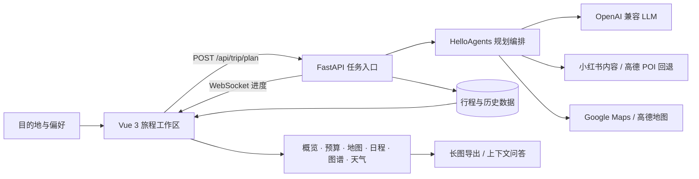

<div align="center">

# TravelAI

### 把模糊的旅行愿望，整理成可以立刻出发的路线

从多城市偏好输入，到逐日行程、预算、地图、天气、灵感图谱与行中问答，TravelAI 把一次旅行放进同一条可理解、可修改、可带走的旅程线索中。

[中文](README.md) · [English](README_en.md) · [日本語](README_ja.md)


</div>


## 旅行规划不该从整理信息开始

想去哪里往往很容易，真正耗时的是把城市、天数、兴趣、交通、住宿、天气和预算拼成一份能执行的安排。TravelAI 的目标不是再生成一篇长攻略，而是把这些零散条件转成一份有结构的旅行工作区：先形成路线，再让用户看懂、调整和继续追问。

整套体验围绕四个动作展开：

1. **说出想法**：填写一个或多个目的地、停留天数、出发日期、交通、住宿、兴趣与特殊需求。
2. **生成旅程**：规划服务在后台组织景点、地理位置、天气、餐饮、住宿与城市间移动，并通过 WebSocket 返回进度。
3. **检查与调整**：在概览、预算、地图、每日行程、灵感图谱和天气之间切换；修改预算或行程后，所有相关视图共享同一份数据。
4. **带着结果出发**：导出完整攻略，或让旅行助手基于当前行程继续回答问题。

## 一份计划，六种观察方式

### 先看全局，再进入每天

行程摘要集中呈现城市、日期、天数、预算和整体建议；每日行程则沿时间线展开景点、交通、住宿、餐饮与预约提示。

#### 行程摘要


#### 每日行程


### 把费用与天气放回决策现场

预算并不是生成后的静态数字。门票、住宿、餐饮、交通与城际交通可以分项查看和编辑；天气面板则按日期和城市呈现温度、天气状况与出行提示。

| 预算明细 | 天气信息 |
| --- | --- |
|  |  |

此外，结果页还提供：

- **景点地图**：Google Maps 优先，高德地图自动回退；地图不可用时保留文字路线。
- **灵感图谱**：把城市、日期、景点、酒店、餐饮和交通组织为可筛选的关系网络。
- **行程编辑**：调整结果后写回当前计划，预算、地图、图谱和导出内容随之更新。
- **旅行助手**：携带完整行程上下文继续问答，不必重复描述背景。
- **攻略导出**：将摘要、日程、预算、天气和地图整理为可保存的长图。

### 景点地图


## 当前产品思路

TravelAI 使用“会呼吸的远行地图”作为统一体验语言。路线、旅程节点、等高线和晨光色彩贯穿输入、生成和结果页；装饰始终退到信息之后。界面支持晨光 / 夜航主题、完整 / 减少动态效果、中文 / English / 日本語，并针对键盘、触摸与移动端布局做了适配。

功能层面遵循三个原则：

- **先给稳定结果，再增强体验**：小红书不可用时回退高德 POI；地图 SDK 不可用时仍显示文字路线；图片失败不会阻断行程。
- **状态必须可见**：加载、空数据、部分数据、失败和重试都有独立界面，不用空白区域表达异常。
- **用户拥有最后决定权**：AI 负责组织信息，用户可以编辑预算、行程和运行时配置，并从历史计划继续出发。

## 系统如何完成一次规划



前端基于 Vue 3、TypeScript、Vite、Ant Design Vue、ECharts 和地图 SDK；后端使用 FastAPI、Pydantic、HelloAgents 与可选的 SQLite 偏好记忆。生产镜像由 FastAPI 同源托管前端静态资源。

## 五分钟启动

### Docker Compose

这是最短的完整启动路径。先复制配置文件并填写至少一组可用的 LLM 配置：

```bash
cp .env.example .env
docker compose up -d --build
```

Windows PowerShell：

```powershell
Copy-Item .env.example .env
docker compose up -d --build
```

浏览器打开 `http://localhost:7860`。容器会同时提供前端页面与 `/api` 服务，`/health` 可用于健康检查。

### 本地开发

后端默认运行在 `8000` 端口：

```powershell
cd backend
python -m venv .venv
.\.venv\Scripts\Activate.ps1
pip install -r requirements.txt
python run.py
```

另开一个终端启动前端；Vite 会把 `/api` 代理到 `http://localhost:8000`：

```powershell
cd frontend
npm ci
npm run dev
```

访问 `http://localhost:5173`。在 `local`、`dev` 或 `staging` 环境下，接口文档位于 `http://localhost:8000/docs`。

## 配置什么，决定看到什么

所有字段都可写入根目录 `.env`。应用允许先启动、后在设置抽屉中补充配置；缺少密钥会提示或启用降级路径，而不是阻止服务启动。

| 配置 | 作用 | 是否必需 |
| --- | --- | --- |
| `LLM_API_KEY` / `LLM_BASE_URL` / `LLM_MODEL_ID` | 行程生成与上下文问答，兼容 OpenAI 格式接口 | 生成行程时必需 |
| `VITE_AMAP_WEB_KEY` | 后端地理编码、POI、天气和路线 | 推荐 |
| `VITE_AMAP_WEB_JS_KEY` / `VITE_AMAP_SECURITY_JS_CODE` | 前端高德地图渲染 | 使用高德地图时必需 |
| `GOOGLE_MAPS_API_KEY` | Google 地理编码与地图能力 | 可选 |
| `XHS_COOKIE` | 从小红书游记提取景点线索与图片 | 可选；失败时自动降级 |
| `ENABLE_USER_MEMORY` | 启用带权重和衰减的旅行偏好记忆 | 可选，默认关闭 |

密钥不会在设置接口中明文回显。运行时保存的设置默认落在 `backend/runtime_settings.json`；请勿提交真实密钥或 Cookie。

## 代码地图

```text
TravelAI/
├─ frontend/                 Vue 3 应用、设计系统与结果页组件
│  ├─ src/components/landing    旅程输入与生成进度
│  ├─ src/components/result     概览、预算、地图、日程、图谱、天气与导出
│  ├─ src/composables           计划状态、地图、编辑、导出与主题逻辑
│  └─ scripts/qa                响应式、可访问性与端到端检查
├─ backend/                  FastAPI 服务与规划编排
│  ├─ app/agents               行程规划 Agent
│  ├─ app/api                  HTTP / WebSocket 接口
│  ├─ app/services             LLM、地图、小红书、图谱与聊天服务
│  ├─ app/memory               可选偏好记忆
│  └─ tests                    后端测试
├─ docs/                     设计说明与验证记录
├─ scripts/capture_readme.cjs README 界面截图工具
└─ docker-compose.yaml       单容器部署入口
```

## 开发与验证

前端提交前至少运行：

```bash
cd frontend
npm run type-check
npm run build
```

后端测试：

```bash
cd backend
pytest
```

README 中的界面图由当前构建和仓库内的标准演示数据生成，不是设计稿。启动前端预览后可用 `scripts/capture_readme.cjs` 重新生成 `docs/images` 中的截图。

> [!NOTE]
> 规划任务状态与 TTL 缓存目前保存在进程内。生产环境应保持单 worker；仓库提供的 `start.sh` 已按这一约束配置。


