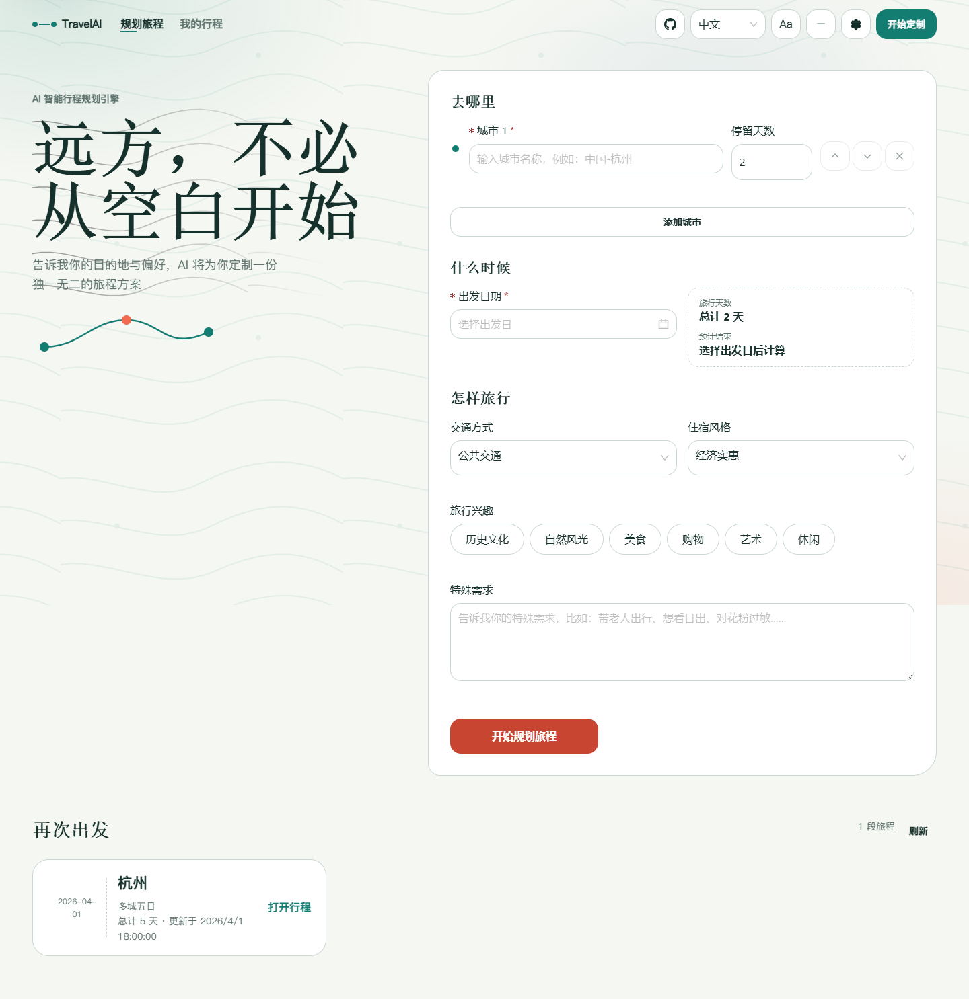
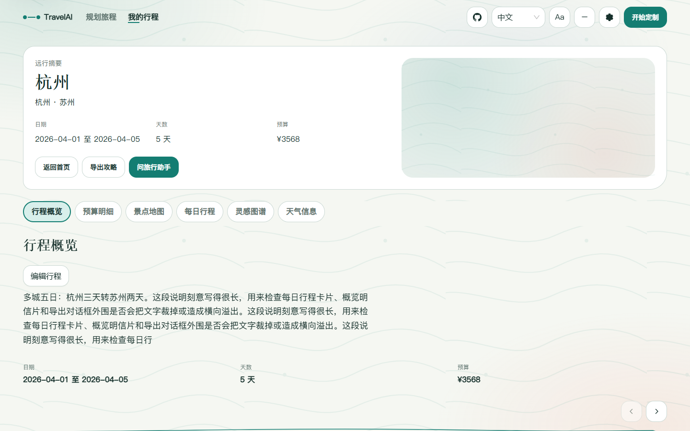
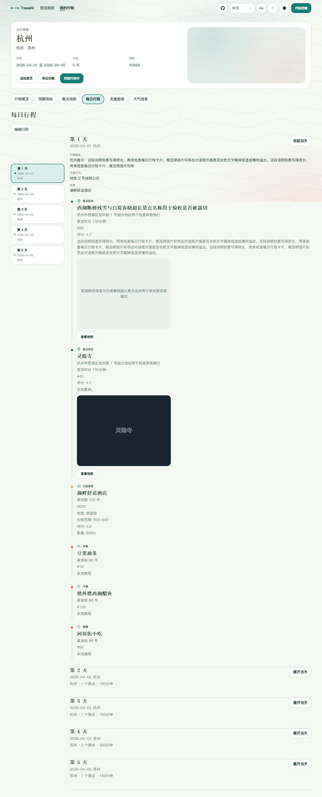
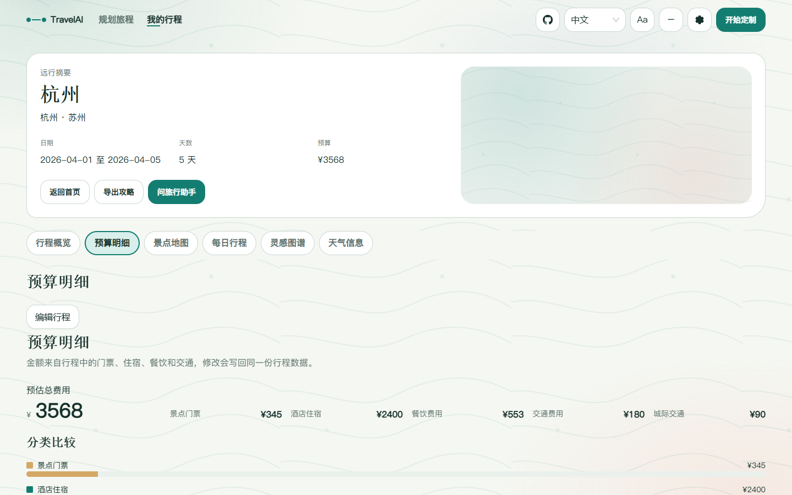
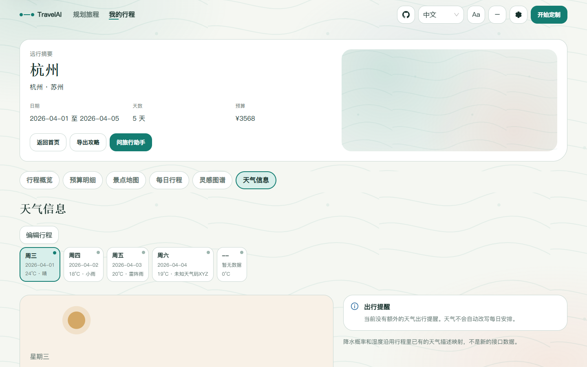
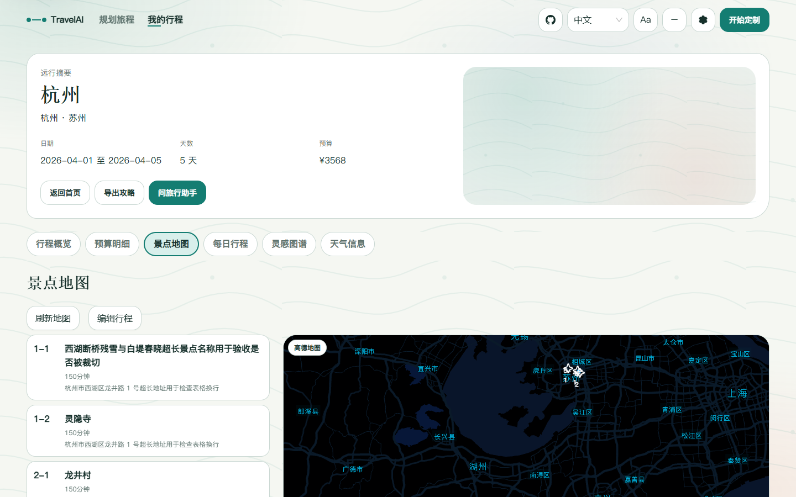
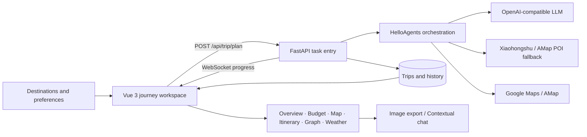

<div align="center">

# TravelAI

### Turn a vague wish to travel into a route you can actually follow

From multi-city preferences to daily schedules, budgets, maps, weather, an inspiration graph, and trip-aware chat, TravelAI keeps the entire journey in one understandable and editable workspace.

[中文](README.md) · [English](README_en.md) · [日本語](README_ja.md)


</div>



## Planning should not begin with information cleanup

Choosing a destination is easy. Turning cities, dates, interests, transport, accommodation, weather, and cost into a workable plan is the slow part. TravelAI is a structured trip workspace rather than another long block of generated travel copy: build a route first, then inspect it, change it, and ask follow-up questions.

The experience follows four actions:

1. **Describe the trip** — add one or more cities, stay lengths, departure date, travel style, interests, and special requirements.
2. **Grow the journey** — the planner assembles attractions, locations, weather, meals, hotels, and inter-city transfers while WebSocket events report progress.
3. **Review and adjust** — move between overview, budget, map, itinerary, inspiration graph, and weather. Edits update the same shared trip data.
4. **Take it with you** — export the complete plan or continue chatting with an assistant that already knows the itinerary.

## One plan, six useful views

The summary brings cities, dates, duration, budget, and guidance together. The itinerary unfolds attractions, transport, accommodation, meals, and reservation reminders along a daily timeline.

### Trip summary



### Daily itinerary



Budget is not a fixed number appended after generation. Admission, hotels, meals, local transport, and inter-city travel can be reviewed and edited. Weather is organized by city and date with conditions and practical travel notes.

| Budget | Weather |
| --- | --- |
|  |  |

The result workspace also includes:

- **Attraction map** — Google Maps first, AMap fallback, and a text route when map rendering is unavailable.
- **Inspiration graph** — a filterable network of cities, dates, attractions, hotels, meals, and transport.
- **Trip editing** — changes flow back into the active plan and its budget, map, graph, and export.
- **Trip-aware assistant** — follow-up questions use the full itinerary as context.
- **Long-image export** — combines the summary, itinerary, budget, weather, and map into a portable guide.

### Attraction map



## Product direction

TravelAI uses a “Living Atlas” visual language. Routes, journey nodes, contour lines, and warm daylight colors connect input, generation, and results while decoration stays behind the information. The interface provides daylight and night themes, full and reduced motion, Chinese / English / Japanese, keyboard navigation, touch targets, and responsive layouts.

Three principles shape the implementation:

- **Return a stable result before adding richness** — Xiaohongshu can fall back to AMap POI, map failure keeps a text route, and image failure never blocks an itinerary.
- **Make state visible** — loading, empty, partial, failed, retrying, and successful states have explicit UI instead of blank panels.
- **Keep the traveler in control** — AI organizes information; the user can edit the itinerary, budget, and runtime settings or resume a saved trip.

## How a plan is produced



The frontend uses Vue 3, TypeScript, Vite, Ant Design Vue, ECharts, and map SDKs. The backend uses FastAPI, Pydantic, HelloAgents, and optional SQLite preference memory. In production, FastAPI serves the compiled frontend from the same image.

## Run it in five minutes

### Docker Compose

Copy the configuration template and provide at least one working LLM configuration:

```bash
cp .env.example .env
docker compose up -d --build
```

PowerShell:

```powershell
Copy-Item .env.example .env
docker compose up -d --build
```

Open `http://localhost:7860`. The container serves both the frontend and `/api`; use `/health` for health checks.

### Local development

Start the backend on port `8000`:

```powershell
cd backend
python -m venv .venv
.\.venv\Scripts\Activate.ps1
pip install -r requirements.txt
python run.py
```

Start the frontend in another terminal. Vite proxies `/api` to `http://localhost:8000`:

```powershell
cd frontend
npm ci
npm run dev
```

Open `http://localhost:5173`. API documentation is available at `http://localhost:8000/docs` in `local`, `dev`, and `staging` environments.

## Configuration and capability

All values can be stored in the root `.env`. The app can start first and accept runtime configuration from its settings drawer later; missing keys show a clear state or use a fallback instead of preventing startup.

| Setting | Purpose | Required? |
| --- | --- | --- |
| `LLM_API_KEY` / `LLM_BASE_URL` / `LLM_MODEL_ID` | Planning and contextual chat through an OpenAI-compatible endpoint | Required to generate plans |
| `VITE_AMAP_WEB_KEY` | Server-side geocoding, POI, weather, and routing | Recommended |
| `VITE_AMAP_WEB_JS_KEY` / `VITE_AMAP_SECURITY_JS_CODE` | AMap rendering in the browser | Required for AMap UI |
| `GOOGLE_MAPS_API_KEY` | Google geocoding and map support | Optional |
| `XHS_COOKIE` | Attraction signals and images from Xiaohongshu posts | Optional; automatically falls back |
| `ENABLE_USER_MEMORY` | Weighted, decaying travel-preference memory | Optional; off by default |

Secrets are never returned in plain text by the settings API. Runtime values are stored in `backend/runtime_settings.json` by default. Never commit real keys or cookies.

## Repository map

```text
TravelAI/
├─ frontend/                 Vue 3 app and design system
│  ├─ src/components/landing    Trip input and planning progress
│  ├─ src/components/result     Overview, budget, map, itinerary, graph, weather, export
│  ├─ src/composables           Trip state, maps, editing, export, theme
│  └─ scripts/qa                Responsive, accessibility, and end-to-end checks
├─ backend/                  FastAPI service and planning orchestration
│  ├─ app/agents               Trip-planning agent
│  ├─ app/api                  HTTP and WebSocket API
│  ├─ app/services             LLM, maps, Xiaohongshu, graph, and chat services
│  ├─ app/memory               Optional preference memory
│  └─ tests                    Backend tests
├─ docs/                     Design and verification records
├─ scripts/capture_readme.cjs README screenshot generator
└─ docker-compose.yaml       Single-container deployment
```

## Development checks

```bash
cd frontend
npm run type-check
npm run build

cd ../backend
pytest
```

The screenshots in this README are rendered by the current build with repository fixtures; they are not design mockups. After starting a frontend preview, `scripts/capture_readme.cjs` can regenerate the images in `docs/images`.

> [!NOTE]
> Planning task state and TTL caches are currently process-local. Production must use a single worker; the supplied `start.sh` already enforces this constraint.

## License

TravelAI is available under the [GNU General Public License v2.0](LICENSE).
