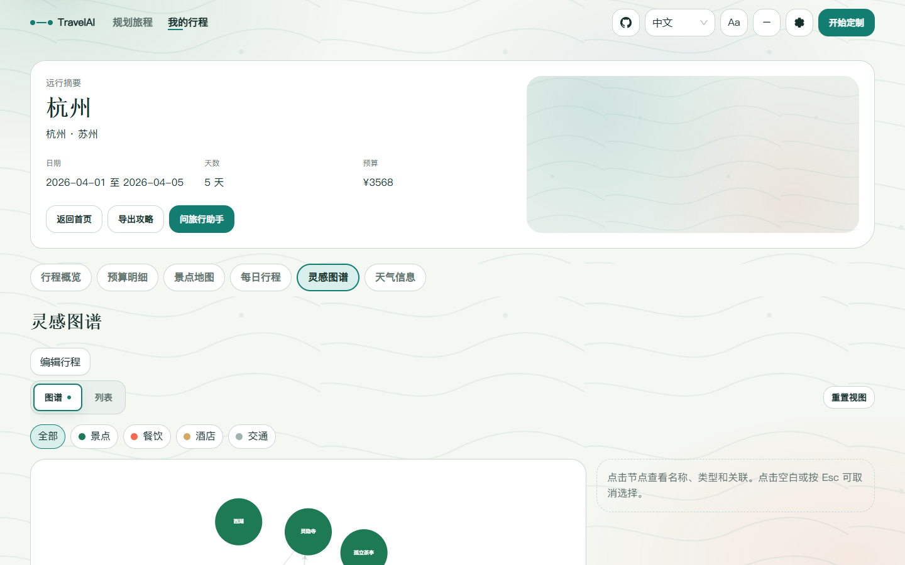
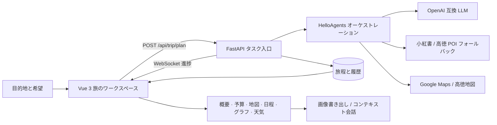

<div align="center">

# TravelAI

### 漠然とした旅の希望を、そのまま歩けるルートへ

複数都市の希望入力から、日別プラン、予算、地図、天気、インスピレーショングラフ、旅程を理解するチャットまで。TravelAI は旅全体を、理解しやすく編集できる一つのワークスペースにまとめます。

[中文](README.md) · [English](README_en.md) · [日本語](README_ja.md)


</div>


## 旅の計画を、情報整理から始めない

行き先を決めるのは簡単でも、都市、日程、興味、交通、宿泊、天気、費用を実行可能な計画にまとめる作業には時間がかかります。TravelAI が目指すのは、長い旅行記事をもう一つ生成することではありません。まずルートを組み立て、その後で確認し、修正し、質問を続けられる構造化された旅のワークスペースです。

体験は四つの動作で構成されています。

1. **旅を伝える** — 一つまたは複数の都市、滞在日数、出発日、移動方法、宿泊スタイル、興味、特別な希望を入力します。
2. **旅程を育てる** — プランナーが観光地、位置情報、天気、食事、ホテル、都市間移動を整理し、WebSocket で進行状況を返します。
3. **確認して調整する** — 概要、予算、地図、日別旅程、グラフ、天気を切り替え、同じ旅程データを編集します。
4. **結果を持ち出す** — 完成したガイドを画像として書き出すか、旅程を理解したアシスタントに続けて質問します。

## 一つの計画を、六つの視点で

旅程概要には都市、日付、日数、予算、全体アドバイスを集約します。日別旅程では、観光地、交通、宿泊、食事、予約の注意点をタイムラインに沿って表示します。

| 旅程概要 | 日別旅程 |
| --- | --- |
|  |  |

予算は生成後に付け足される固定値ではありません。入場料、宿泊、食事、市内交通、都市間交通を項目ごとに確認・編集できます。天気は都市と日付ごとに整理され、状況と実用的な移動ヒントを表示します。

| 予算明細 | 天気情報 |
| --- | --- |
|  |  |

結果ワークスペースには、さらに次の機能があります。

- **観光地マップ** — Google Maps を優先し、高徳地図へ自動フォールバック。地図を表示できない場合もテキストルートを残します。
- **インスピレーショングラフ** — 都市、日付、観光地、ホテル、食事、交通をフィルター可能な関係ネットワークとして表示します。
- **旅程編集** — 変更内容は現在の計画に戻り、予算、地図、グラフ、書き出しにも反映されます。
- **旅行アシスタント** — 完全な旅程をコンテキストとして追加質問に答えます。
- **長画像エクスポート** — 概要、日程、予算、天気、地図を一つの持ち運べるガイドにまとめます。

| 観光地マップ | インスピレーショングラフ |
| --- | --- |
|  |  |

## 現在のプロダクト方針

TravelAI は「呼吸する遠方の地図（Living Atlas）」を共通のビジュアル言語にしています。ルート、旅のノード、等高線、朝の光を思わせる色が、入力・生成・結果をつなぎ、装飾は情報の背後に置かれます。朝光 / 夜航テーマ、通常 / 低モーション、中国語 / English / 日本語、キーボード操作、タッチ操作、レスポンシブレイアウトに対応しています。

実装は三つの原則に従います。

- **表現を増やす前に、安定した結果を返す** — 小紅書が使えない場合は高徳 POI、地図が失敗した場合はテキストルートへ切り替え、画像失敗で旅程を止めません。
- **状態を見える形にする** — 読み込み、空、部分データ、失敗、再試行、成功を空白ではなく明確な UI で示します。
- **最後の判断は旅行者に残す** — AI は情報を整理し、ユーザーは旅程、予算、実行時設定を編集し、保存済みの旅から再開できます。

## 一つの旅程ができるまで



フロントエンドは Vue 3、TypeScript、Vite、Ant Design Vue、ECharts、地図 SDK を使用します。バックエンドは FastAPI、Pydantic、HelloAgents と任意の SQLite ユーザー嗜好メモリで構成されています。本番イメージでは FastAPI がビルド済みフロントエンドを同一オリジンで配信します。

## 5 分で起動

### Docker Compose

設定テンプレートをコピーし、少なくとも一つの有効な LLM 設定を入力します。

```bash
cp .env.example .env
docker compose up -d --build
```

PowerShell：

```powershell
Copy-Item .env.example .env
docker compose up -d --build
```

`http://localhost:7860` を開きます。コンテナはフロントエンドと `/api` を同時に提供し、`/health` で稼働確認できます。

### ローカル開発

```powershell
cd backend
python -m venv .venv
.\.venv\Scripts\Activate.ps1
pip install -r requirements.txt
python run.py
```

別のターミナルでフロントエンドを起動します。Vite は `/api` を `http://localhost:8000` にプロキシします。

```powershell
cd frontend
npm ci
npm run dev
```

`http://localhost:5173` を開きます。`local`、`dev`、`staging` 環境では、API ドキュメントを `http://localhost:8000/docs` で確認できます。

## 設定と利用できる機能

すべての値はルートの `.env` に保存できます。アプリを先に起動し、後から設定ドロワーで追加することもできます。キーがない場合は明確な状態表示またはフォールバックを使用し、起動自体は妨げません。

| 設定 | 用途 | 必須か |
| --- | --- | --- |
| `LLM_API_KEY` / `LLM_BASE_URL` / `LLM_MODEL_ID` | OpenAI 互換 API による旅程生成と会話 | 旅程生成時に必須 |
| `VITE_AMAP_WEB_KEY` | サーバー側ジオコーディング、POI、天気、ルート | 推奨 |
| `VITE_AMAP_WEB_JS_KEY` / `VITE_AMAP_SECURITY_JS_CODE` | ブラウザーでの高徳地図表示 | 高徳地図 UI に必須 |
| `GOOGLE_MAPS_API_KEY` | Google のジオコーディングと地図機能 | 任意 |
| `XHS_COOKIE` | 小紅書の投稿から観光地情報と画像を取得 | 任意、自動フォールバックあり |
| `ENABLE_USER_MEMORY` | 重みと減衰を持つ旅行嗜好メモリ | 任意、既定は無効 |

設定 API はシークレットを平文で返しません。実行時設定は既定で `backend/runtime_settings.json` に保存されます。実際のキーや Cookie をコミットしないでください。

## リポジトリ案内

```text
TravelAI/
├─ frontend/                 Vue 3 アプリとデザインシステム
│  ├─ src/components/landing    旅の入力と生成進捗
│  ├─ src/components/result     概要、予算、地図、日程、グラフ、天気、出力
│  ├─ src/composables           状態、地図、編集、出力、テーマ
│  └─ scripts/qa                レスポンシブ、アクセシビリティ、E2E 検証
├─ backend/                  FastAPI とプランニング処理
│  ├─ app/agents               旅行計画 Agent
│  ├─ app/api                  HTTP / WebSocket API
│  ├─ app/services             LLM、地図、小紅書、グラフ、チャット
│  ├─ app/memory               任意の嗜好メモリ
│  └─ tests                    バックエンドテスト
├─ docs/                     デザインと検証記録
├─ scripts/capture_readme.cjs README 画像生成ツール
└─ docker-compose.yaml       単一コンテナ配備
```

## 開発時の確認

```bash
cd frontend
npm run type-check
npm run build

cd ../backend
pytest
```

README の画像は現在のビルドとリポジトリ内の標準データから生成されており、デザインモックではありません。フロントエンドのプレビュー起動後、`scripts/capture_readme.cjs` で `docs/images` の画像を再生成できます。

> [!NOTE]
> 計画タスク状態と TTL キャッシュは現在プロセス内にあります。本番環境では single worker が必要で、付属の `start.sh` はこの制約に合わせて設定されています。

## License

本プロジェクトは [GNU General Public License v2.0](LICENSE) のもとで公開されています。
